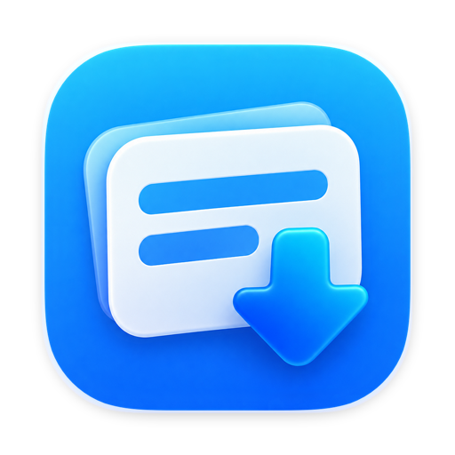
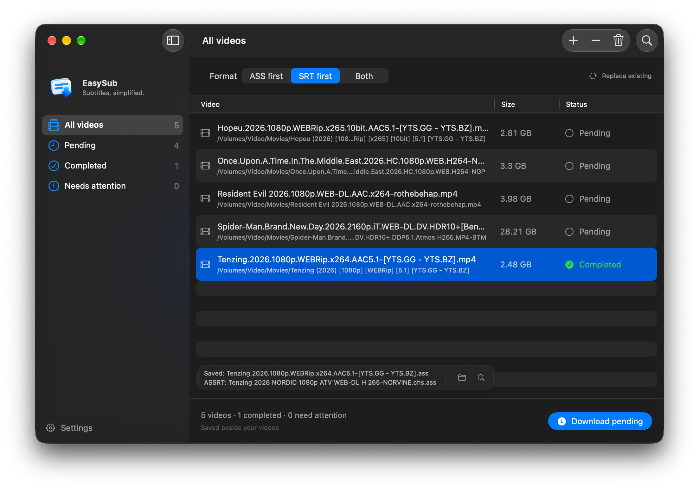

<p align="center">
  
</p>

<p align="center">
  <strong>简体中文</strong> · <a href="README.en.md">English</a>
</p>

<p align="center">
  <a href="https://github.com/umlearn/EasySub/actions/workflows/ci.yml">
    
  </a>
  
  
  
  <a href="LICENSE.md">
    
  </a>
  <a href="https://easysub.umlearn.tech/">
    
  </a>
</p>

## EasySub

EasySub 是一款原生 macOS 字幕下载工具。把视频或文件夹拖进窗口，它会从多个字幕来源并行搜索，根据片名、年份、季集、语言和来源可信度自动选择合适的字幕，并保存到视频所在目录。

应用使用 **Swift 6 + SwiftUI** 构建，支持 Apple Silicon 与 Intel Mac，无第三方运行时依赖。

<p align="center">
  
</p>

## ✨ 功能

- 拖放视频或文件夹，自动递归扫描、过滤并去重
- 支持 ASS 优先、SRT 优先或两种格式同时下载
- 并行查询 OpenSubtitles、迅雷、ASSRT 与 Shooter，失败时自动尝试其他来源
- 支持三档字幕语言偏好，自动按语言顺序回退，手动搜索仍可查看全部语言
- 自动识别电影年份、电视剧季集和字幕语言，减少错误匹配
- 支持在下载前查看候选字幕并手动选择
- 默认保留已有字幕，也可选择原子替换
- 支持失败重试、任务取消、访达定位和完成通知
- 简体中文与 English，可独立于系统语言切换
- 适配 macOS 浅色与深色外观

支持的视频格式包括 MKV、MOV、MP4、M4V、RMVB、AVI、MPEG、MPG、TS、M2TS 和 WebM。

## 🚀 安装

### 下载预构建版本

可以从 [GitHub Releases](https://github.com/umlearn/EasySub/releases/latest) 下载最新版本。

当前发布的 EasySub 尚未使用 Apple Developer ID 签名或公证。首次打开时，macOS 可能提示无法验证开发者。请在 Finder 中右键点击 EasySub，选择“打开”；如果仍被阻止，请前往“系统设置 → 隐私与安全性”，确认打开该应用。

请仅从本项目的 GitHub Releases 页面下载安装包。

### 从源码构建

需要 macOS 14 或更高版本，以及 Xcode 16 或更高版本。

```sh
git clone https://github.com/umlearn/EasySub.git
cd EasySub
open EasySub.xcodeproj
```

在 Xcode 中选择 `EasySub` scheme 后运行，或在终端构建 Release 版本：

```sh
xcodebuild -project EasySub.xcodeproj -scheme EasySub \
  -configuration Release -destination 'generic/platform=macOS' \
  -derivedDataPath build CODE_SIGNING_ALLOWED=NO build
```

应用将生成在 `build/Build/Products/Release/EasySub.app`。本地构建同样未签名。

## 🕹 使用

1. 将视频或文件夹拖入 EasySub，也可以按 `⌘O` 选择文件。
2. 选择 ASS 优先、SRT 优先或两种格式。
3. 点击“下载待处理项”，或按 `⌘Return`。
4. 下载完成后，字幕会出现在对应视频的目录中。

迅雷和 ASSRT 默认开启；ASSRT 需要先在“设置 → 字幕来源”中填写 Token 才会参与搜索。OpenSubtitles 默认关闭并需要 API Key；Shooter 依赖视频文件指纹，适合查找特定旧版视频，但当前匹配率较低，因此默认关闭。

如果自动匹配不够可靠，可以右键单个视频并选择“手动搜索字幕”，检查候选结果后再下载。

## 📚 文档

- [字幕来源](docs/providers.html)：各来源的配置、验证状态、隐私策略与已知限制
- [本地化指南](docs/localization.html)：完善现有翻译或添加新语言

项目网站是位于 `docs/` 的纯静态页面，不需要 Node 构建或单独的部署工作流。发布时在 GitHub 仓库的 **Settings → Pages** 中选择 **Deploy from a branch**，使用默认分支和 `/docs` 目录即可。

## 🧑‍💻 开发

核心逻辑作为独立 Swift Package 维护，不依赖真实网络或用户视频即可运行测试：

```sh
swift test
```

项目的主要目录：

- `Sources/EasySubApp`：SwiftUI 界面、设置、通知与本地化
- `Sources/EasySubCore`：扫描、匹配、下载、文件写入与多来源聚合
- `Tests/EasySubCoreTests`：Swift Testing 测试与网络替身
- `Scripts/generate_project.py`：生成可复现的 Xcode 工程配置

新增或删除 Swift 文件后，请运行：

```sh
python3 Scripts/generate_project.py
```

## 系统要求

- macOS 14 Sonoma 或更高版本
- Apple Silicon 或 Intel Mac
- Xcode 16 或更高版本（仅源码构建需要）

## 致谢

感谢所有为 EasySub 提供代码、反馈和建议的贡献者，以及 [Shooter.cn](https://www.shooter.cn)、[FileLister](https://github.com/dwkns/FileLister) 和 [ShooterSubPyDownloader](https://github.com/magic282/ShooterSubPyDownloader)。

## 许可证

EasySub 采用 [BSD 3-Clause License](LICENSE.md)。
